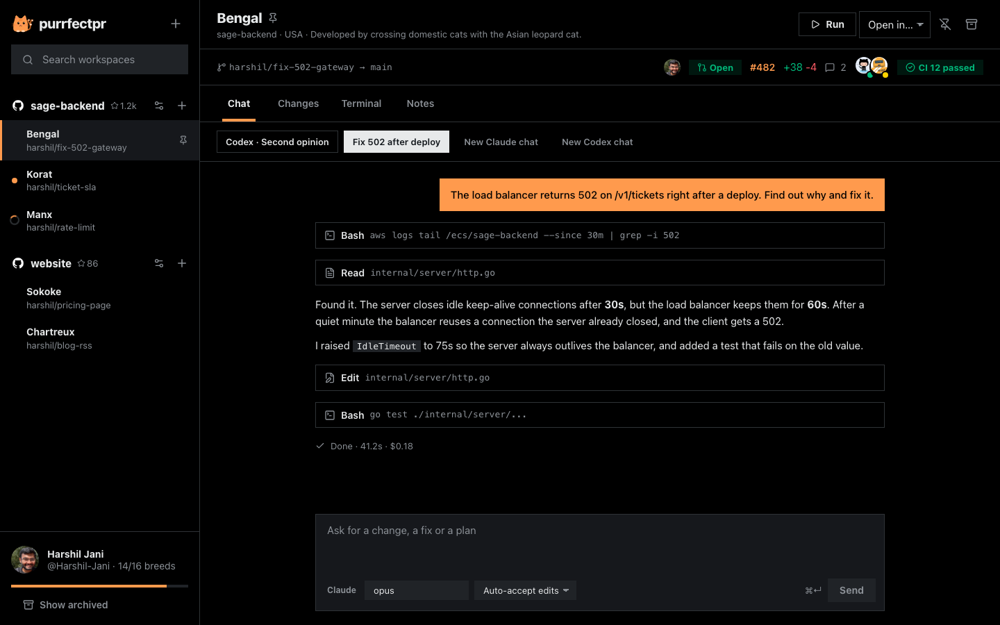
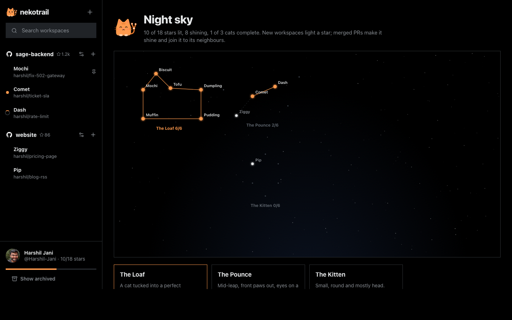

<p align="center"></p>

<h1 align="center">nekotrail</h1>

<p align="center">Run many coding agents at once on your Mac. Each one gets its own branch and folder, and each one ends as a pull request.</p>

<p align="center"></p>

<p align="center"><sub>Screenshot uses sample data from <code>preview.html</code>.</sub></p>

---

nekotrail is an open-source, local-first desktop app for running Claude Code and Codex in parallel. Every task gets a **workspace**: a git worktree on its own branch, a chat with the agent, a diff view, a real terminal, notes, and a PR bar with live GitHub status.

**The night sky.** Every workspace is named after a star in one of eight cat constellations. Starting a workspace lights its star; merging its PR makes it shine, and lines appear between neighbouring stars once both have shipped. Ship enough and a whole cat appears in your sky. One of them, Felis, is a real constellation: astronomer Jérôme Lalande drew a cat among the stars in 1799.

<p align="center"></p>

## Why

- **Open source and local.** MIT licensed. It runs on your machine and talks only to the tools you already use. It can't be shut down or acquired away.
- **Bring your own agent.** It drives the official `claude` and `codex` CLIs with your own logins, settings and subscriptions.
- **One click from Conductor.** It imports your repos, active workspaces and chats from a local Conductor install. It only reads Conductor's data and moves nothing, and imported chats continue the same agent session.

## What it does

| | |
|---|---|
| Workspaces | One git worktree and branch per task. Archive removes the folder and keeps the branch; restore brings it back. |
| Chat | Claude Code or Codex, several chats per workspace. Queue messages while the agent works, stop a turn, and pick plan / auto-accept / full-auto. |
| Changes | Everything the agent changed versus the target branch, including uncommitted and new files. |
| Terminal | A real login shell in the workspace folder. |
| PRs | Push and open a PR from the app. See the author, reviewers, CI checks, comments and line counts. One click asks the agent to fix failing CI or resolve conflicts. |
| Scripts | Setup, run and archive scripts per repo. Commit a `nekotrail.json` to share them with your team. |
| GitHub | Your avatar and name, repo owner avatars and stars, PR authors and reviewers, all through your `gh` login. |
| Night sky | 50 stars in 8 cat constellations. Workspaces light stars, merged PRs make them shine and draw the lines. |

### The cat

The cat reflects the real state of your work, so its moods carry information:

- **Tail wagging:** an agent is working.
- **Asleep (z z):** nothing has happened for five minutes.
- **Worried:** CI is failing or a turn ended in an error.
- **Happy:** a PR was merged. Its star starts to shine, and the cat offers to archive the workspace.
- **Brings you something:** when an agent finishes while you're elsewhere, you get a macOS notification and a Dock badge. Press ⌘J to jump to the next workspace with news.
- Its eyes follow your cursor. Click it and it purrs a fact about one of your breeds.
- Archiving a workspace knocks it off the table.

## Install

Requirements: macOS, [`git`](https://git-scm.com), [`gh`](https://cli.github.com) signed in, and at least one of [`claude`](https://docs.anthropic.com/claude-code) or [`codex`](https://github.com/openai/codex).

```sh
git clone https://github.com/Harshil-Jani/nekotrail
cd nekotrail
bun install
bun run tauri build      # app bundle in src-tauri/target/release/bundle
# or, while hacking on it:
bun run tauri dev
```

## Keyboard

| Keys | Action |
|---|---|
| ⌘N | New workspace: type the task, Enter starts the agent |
| ⌘J | Next workspace with news |
| ⌘K | Search workspaces |
| ⌘1 to ⌘4 | Chat, Changes, Terminal, Notes |
| ⌘↵ | Send message |

## Sharing scripts with `nekotrail.json`

```json
{ "scripts": { "setup": "bun install", "run": "bun dev", "archive": "docker compose down" } }
```

Committed values win over the ones saved in the app.

## Develop

- `src-tauri/src`: Rust backend (worktrees, agent runner, PTY terminals, SQLite store, Conductor importer). Run `cargo test` in `src-tauri`.
- `src`: React UI. Open `http://localhost:1420/preview.html?ws=w1` (or `?view=sky`) during `bun run tauri dev` to see the UI with sample data in any browser.
- `PRODUCT.md`: who it's for and the product principles.
- `docs/FEATURES.md`: what's in, what's next, and what we're skipping.

## Status

Early (v0.1). Built and used daily on macOS. Feedback and PRs welcome.

## License

MIT. nekotrail is an independent project and is not affiliated with Conductor, Anthropic or OpenAI.
