<div align="center">


<p><picture><source media="(prefers-color-scheme: dark)" srcset="brand/wordmark/nekotrail-wordmark-light.svg"></picture></p>

<h3>Your coding agents, all at once.</h3>

<p>Claude Code, Codex and 14 more on your logins, each in its own worktree.<br>Free, MIT, no account.</p>

<p>
<a href="https://github.com/Harshil-Jani/nekotrail/releases/latest"></a>
<a href="https://github.com/Harshil-Jani/nekotrail/releases"></a>
<a href="LICENSE"></a>
<a href="#install"></a>
<a href="https://github.com/Harshil-Jani/nekotrail/stargazers"></a>
</p>

<p>
<a href="https://github.com/Harshil-Jani/nekotrail/releases/latest"><picture><source media="(prefers-color-scheme: dark)" srcset="docs/readme/buttons/download-mac-dark.svg"></picture></a>&nbsp;
<a href="https://github.com/Harshil-Jani/nekotrail/releases/latest"><picture><source media="(prefers-color-scheme: dark)" srcset="docs/readme/buttons/download-linux-dark.svg">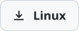</picture></a>&nbsp;
<a href="https://harshil-jani.github.io/nekotrail/"><picture><source media="(prefers-color-scheme: dark)" srcset="docs/readme/buttons/website-dark.svg"></picture></a>
</p>

<p>
<a href="https://github.com/sponsors/Harshil-Jani"><picture><source media="(prefers-color-scheme: dark)" srcset="docs/readme/buttons/sponsor-dark.svg"></picture></a>&nbsp;
<a href="https://buymeacoffee.com/harshiljani"></a>
</p>

<br>

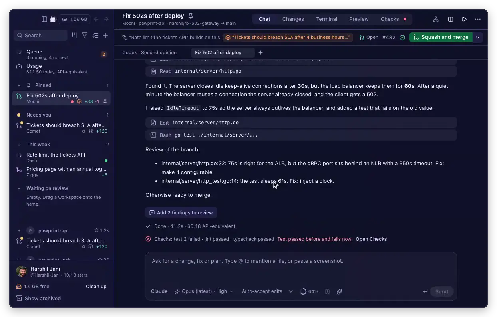

<p><sub>Every task gets a <b>workspace</b>: a git worktree on its own branch, plus a chat, a diff, a live preview, a terminal and a PR bar with GitHub status.</sub></p>

</div>

<br>

## Why NekoTrail

<table>
<tr>
<td width="50%" valign="top">
<picture><source media="(prefers-color-scheme: dark)" srcset="docs/readme/icons/code-dark.svg">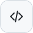</picture><br>
<b>Open source and local.</b><br>
MIT. Workspaces, branches and chats stay on your disk.
</td>
<td width="50%" valign="top">
<picture><source media="(prefers-color-scheme: dark)" srcset="docs/readme/icons/key-dark.svg"></picture><br>
<b>Your agents, your logins.</b><br>
Sixteen agents through their official CLIs. No proxy, no markup.
</td>
</tr>
<tr>
<td width="50%" valign="top">
<picture><source media="(prefers-color-scheme: dark)" srcset="docs/readme/icons/handoff-dark.svg"></picture><br>
<b>Hand off without starting over.</b><br>
When an agent runs out of usage or loops, another carries on in the same branch, from a brief you read first.
</td>
<td width="50%" valign="top">
<picture><source media="(prefers-color-scheme: dark)" srcset="docs/readme/icons/shield-dark.svg"></picture><br>
<b>Conductor work, kept safe.</b><br>
Nothing is copied or deleted: git renames each worktree's folder and NekoTrail checks it.
</td>
</tr>
</table>

## Tour

Screenshots use sample data. Light and dark follow your Mac.

<table>
<tr>
<td width="50%" valign="top">
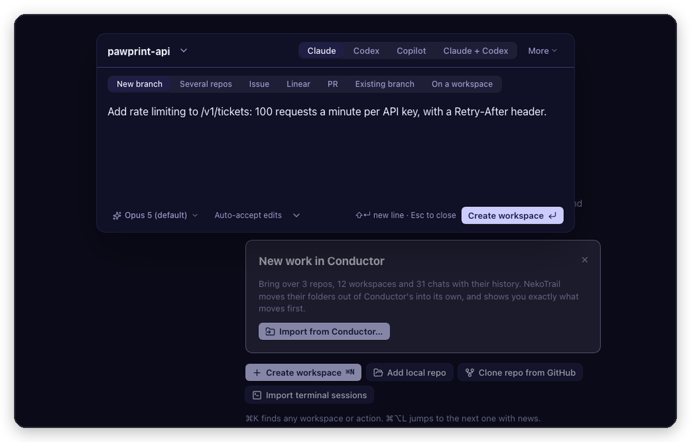<br>
<b>Start a workspace.</b><br>
Type the task, press Enter. Start from a GitHub or Linear issue, a PR, a branch or another workspace.
</td>
<td width="50%" valign="top">
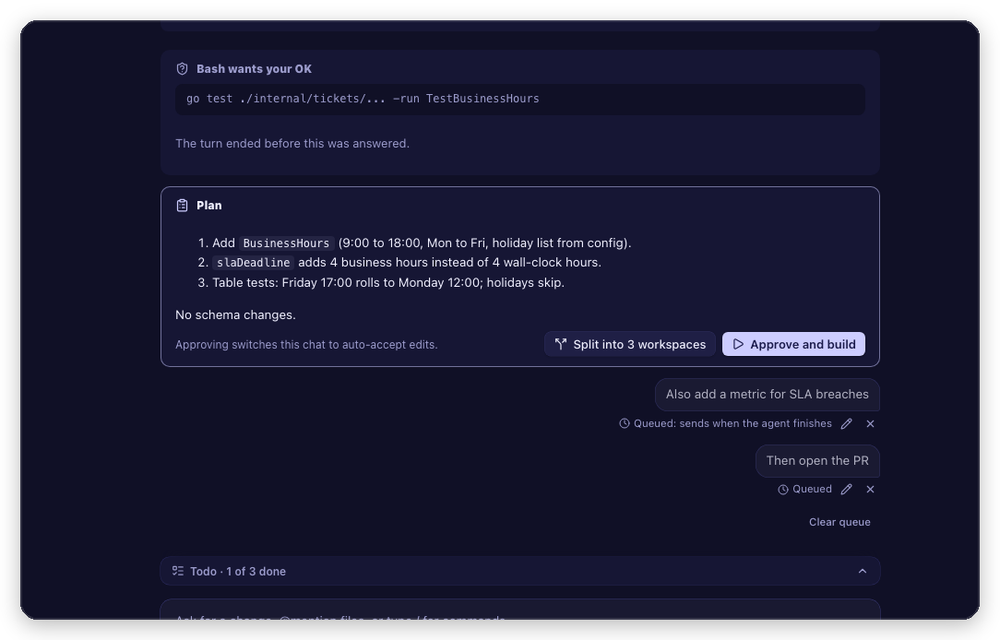<br>
<b>Approve the plan, or split it</b><br>
into parallel workspaces (<kbd>⌘⇧↵</kbd>).
</td>
</tr>
<tr>
<td width="50%" valign="top">
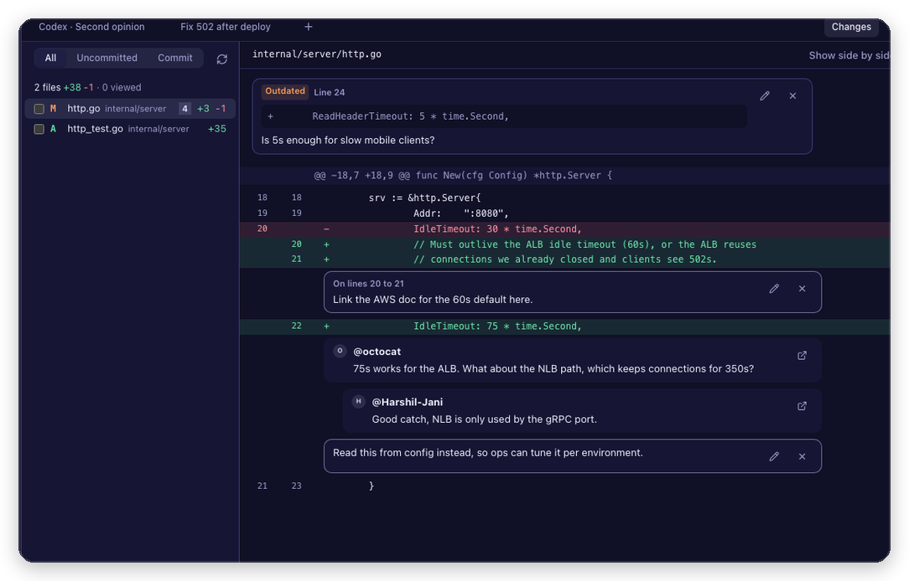<br>
<b>Review it like a PR.</b><br>
Click a line number to comment. Send review hands every comment to the agent in one message.
</td>
<td width="50%" valign="top">
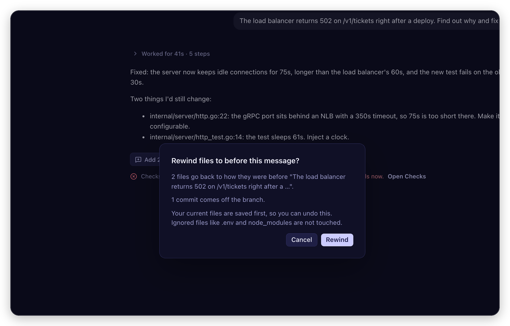<br>
<b>Rewind to here.</b><br>
Every message you send saves your files first. Rewind puts them back, and can be undone.
</td>
</tr>
<tr>
<td width="50%" valign="top">
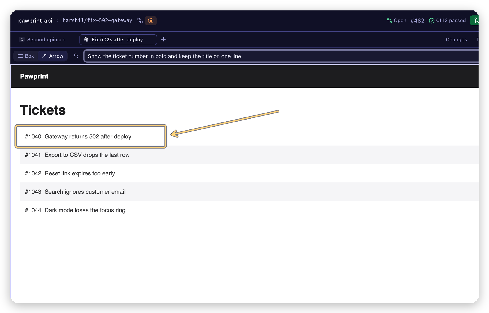<br>
<b>See your app and mark it up</b> (<kbd>⌘4</kbd>).<br>
Draw on the running page and send it to the agent as a screenshot.
</td>
<td width="50%" valign="top">
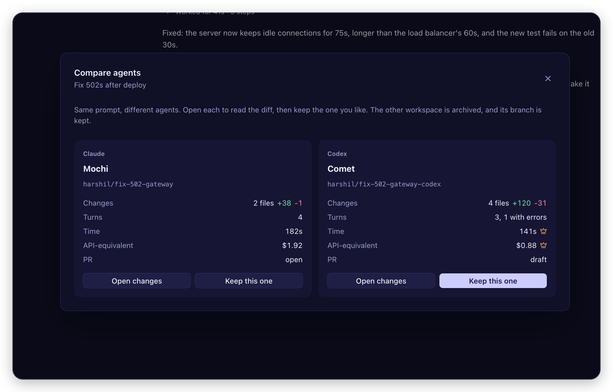<br>
<b>Race Claude and Codex.</b><br>
Same task, two workspaces. Compare files, time and cost; keep the winner.
</td>
</tr>
<tr>
<td width="50%" valign="top">
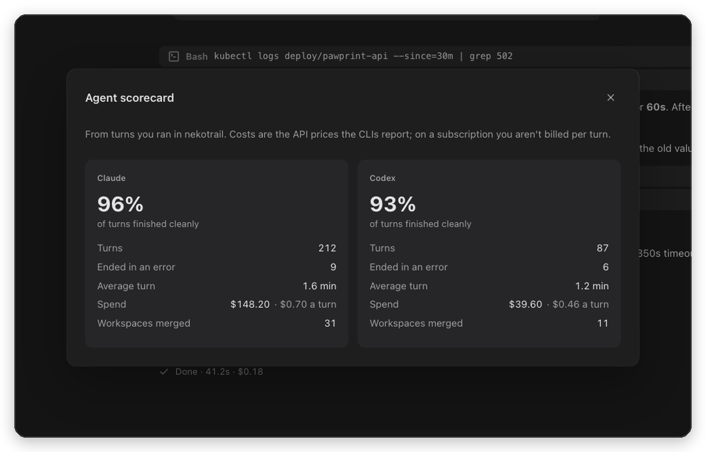<br>
<b>See which agent works for you.</b><br>
Finish rate, turn time, spend and merged PRs, from your own history.
</td>
<td width="50%" valign="top">
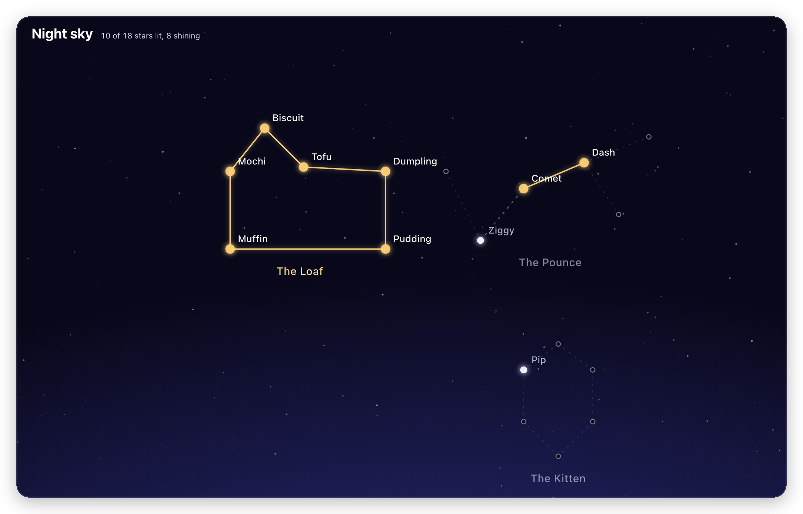<br>
<b>Light up the night sky.</b><br>
Every workspace is a star in a cat constellation. Merged PRs make it shine.
</td>
</tr>
</table>

<details>
<summary><b>Eight more screens</b></summary>
<br>
<table>
<tr>
<td width="50%" valign="top">
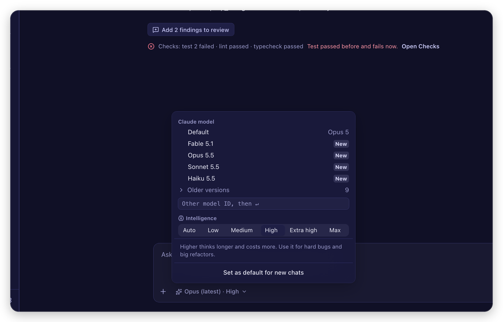<br>
<b>Pick the model and how hard it thinks</b> (<kbd>⌘/</kbd>).
</td>
<td width="50%" valign="top">
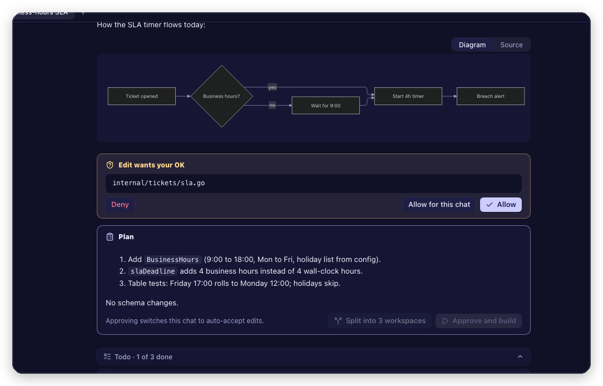<br>
<b>Or approve each change.</b><br>
In Ask before changes, every edit and command waits for Allow (<kbd>↵</kbd>) or Deny (<kbd>⌫</kbd>).
</td>
</tr>
<tr>
<td width="50%" valign="top">
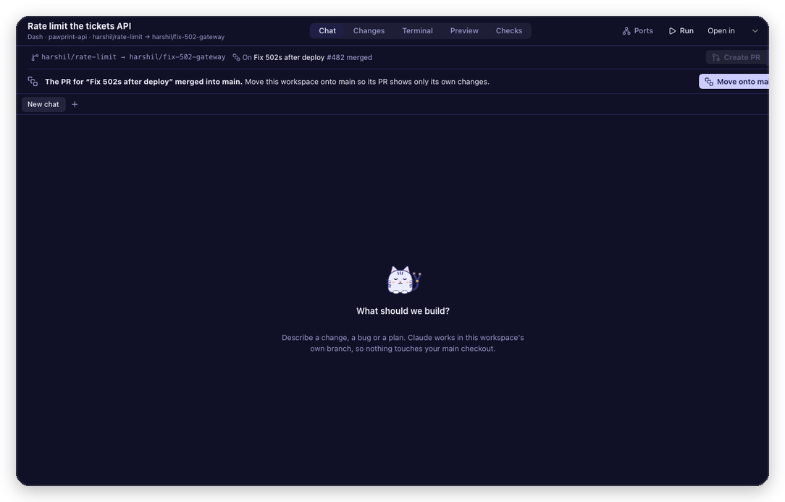<br>
<b>Stack work on work.</b><br>
Build on an unmerged workspace. When the parent merges, one click moves it onto main.
</td>
<td width="50%" valign="top">
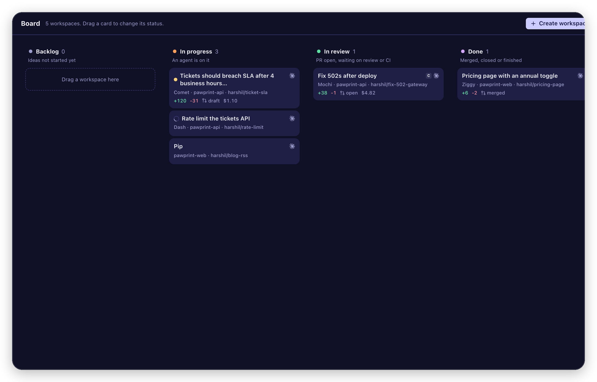<br>
<b>See everything on a board</b> (<kbd>⌘⇧K</kbd>).<br>
Drag to change status.
</td>
</tr>
<tr>
<td width="50%" valign="top">
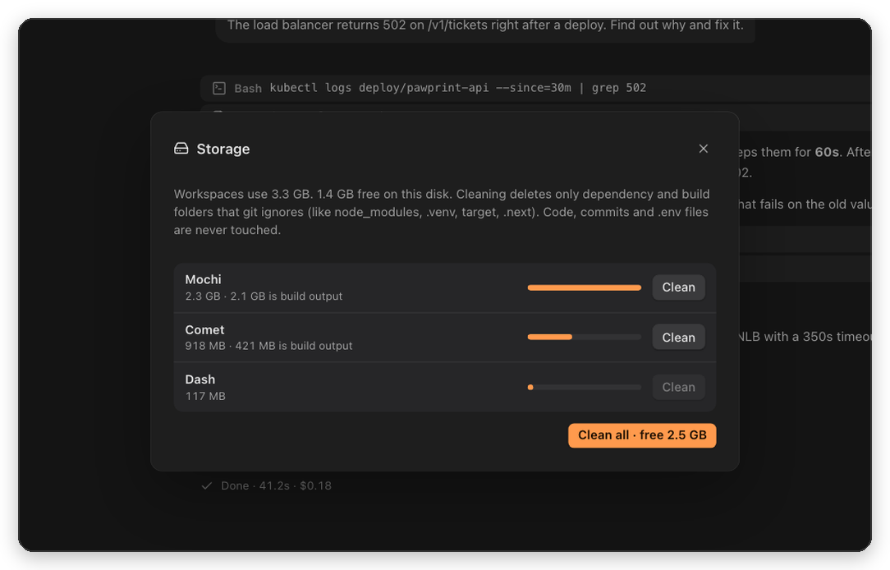<br>
<b>Get disk space back.</b><br>
See each workspace's size and clean ignored build folders in one click.
</td>
<td width="50%" valign="top">
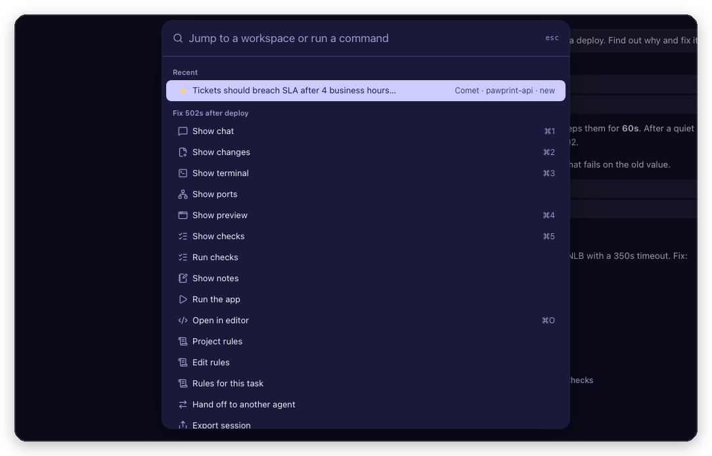<br>
<b>Do anything from the keyboard.</b><br>
<kbd>⌘K</kbd> jumps to any workspace or action.
</td>
</tr>
<tr>
<td width="50%" valign="top">
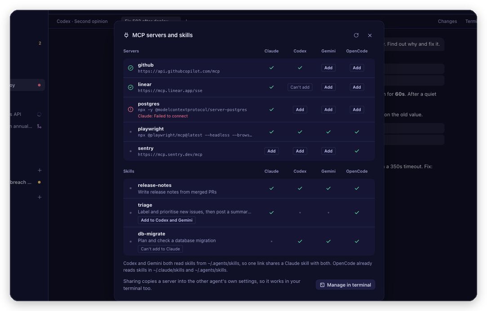<br>
<b>Share MCP servers.</b><br>
Type <code>/mcp</code> to see every agent's servers and copy one to another agent.
</td>
<td width="50%" valign="top">
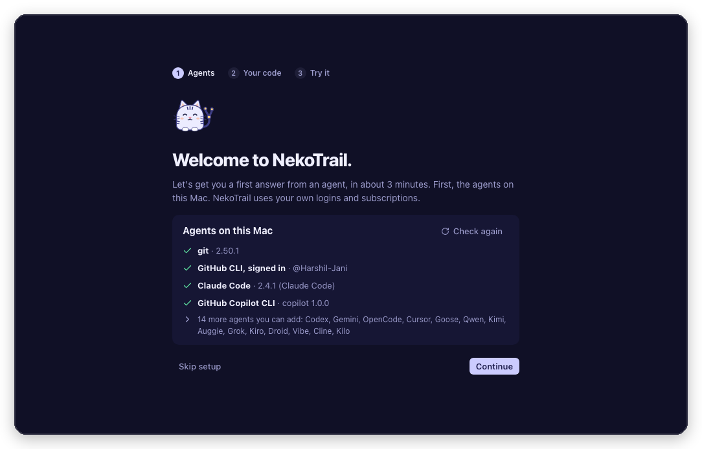<br>
<b>First launch checks your setup.</b><br>
It shows the command for anything missing and offers the Conductor import.
</td>
</tr>
</table>
</details>

## Sixteen agents, one window

<p align="center">Through their official CLIs, on your own logins and subscriptions. No proxy, no markup.</p>

<table align="center">
<tr><td width="25%">Claude Code</td><td width="25%">Codex</td><td width="25%">Gemini CLI</td><td width="25%">OpenCode</td></tr>
<tr><td>Cursor</td><td>GitHub Copilot</td><td>Goose</td><td>Qwen Code</td></tr>
<tr><td>Kimi</td><td>Auggie</td><td>Grok</td><td>Kiro</td></tr>
<tr><td>Droid</td><td>Mistral Vibe</td><td>Cline</td><td>Kilo</td></tr>
</table>

## Install

**macOS 13 or later.** The app isn't notarized yet, so macOS blocks it on first launch until you clear the download quarantine flag once.

1. Download the `.dmg` from the [latest release](https://github.com/Harshil-Jani/nekotrail/releases/latest), open it and drag NekoTrail to Applications.
2. Run this once in Terminal:

   ```sh
   xattr -dr com.apple.quarantine /Applications/nekotrail.app
   ```

3. Open NekoTrail as usual. It checks your setup on first launch and gives you the exact command for anything missing.

**Requirements:** [`git`](https://git-scm.com), [`gh`](https://cli.github.com) signed in, and at least one agent CLI, such as [`claude`](https://docs.anthropic.com/claude-code), [`codex`](https://github.com/openai/codex), [`gemini`](https://github.com/google-gemini/gemini-cli) or [`opencode`](https://opencode.ai). Setup lists all sixteen with their install commands.

**Updates.** NekoTrail checks for a new release on launch and every 6 hours, and offers to update itself (<kbd>⌘K</kbd> → Check for updates, or Settings). It waits for your agents before restarting. If you're on 0.10.1 or earlier, install the latest release from the download link once by hand: those versions can't update themselves yet.

<details>
<summary><b>Linux (new, experimental)</b></summary>
<br>

Since 0.14.0, each release also carries an x86_64 `.deb` and `.AppImage`. This is new and has not been tested on real Linux machines yet, so expect rough edges and please [report them](https://github.com/Harshil-Jani/nekotrail/issues/new/choose).

- **Debian, Ubuntu and similar:** download the `.deb` and run `sudo apt install ./nekotrail_*_amd64.deb`.
- **Other distros:** download the `.AppImage`, make it executable (`chmod +x nekotrail_*.AppImage`) and run it. It needs glibc 2.35 or newer (Ubuntu 22.04 era).
- Both update themselves from inside the app. A `.deb` update asks for your password, since it installs with `pkexec`.
- Shortcuts use Ctrl where the Mac uses ⌘. Two moves: switching workspace is Alt+1 to Alt+9 (Ctrl+1 to Ctrl+4 switch tabs), and Open in editor is Ctrl+Shift+O (Ctrl+O shows tool output). In the terminal, Ctrl keys go to your shell; copy and paste are Ctrl+Shift+C and Ctrl+Shift+V. Settings, Shortcuts lists them all.
- Not on Linux yet: the Conductor import (Conductor is Mac-only), vibrancy, and the Dock badge (most Linux desktops don't show one). Annotate in Preview uses WebKitGTK's own snapshot and is the least tested part.
- Requirements as above, plus WebKitGTK 4.1 (`libwebkit2gtk-4.1-0`, pulled in by the `.deb`).

</details>

<details>
<summary><b>Build it yourself</b></summary>
<br>

```sh
git clone https://github.com/Harshil-Jani/nekotrail
cd nekotrail
bun install
bun run tauri build -c '{"bundle":{"createUpdaterArtifacts":false}}'   # app bundle in src-tauri/target/release/bundle
# (release builds also sign an update archive; that needs the maintainers' updater key)
# or, while hacking on it:
bun run tauri dev
```

</details>

## Moving from Conductor?

> One import brings over your repos, active workspaces and chats, then moves your worktrees out of Conductor's folder with `git worktree move`. Same shortcuts, same agent sessions. **[What comes over →](docs/MOVING-FROM-CONDUCTOR.md)**

## Reference

<details>
<summary><b>Everything it does</b></summary>
<br>

| | |
|---|---|
| Start | Open a local repo, clone a GitHub repo, or import from Conductor. Start from a task, a GitHub or Linear issue, a PR or a branch. |
| Workspaces | One worktree and branch per task. Archive removes the folder and keeps the branch. |
| Chat | Any of the sixteen agents, several chats per workspace. Queue messages, `@` a file, paste a screenshot. Modes: plan, auto-accept, full-auto. |
| Compare agents | Pick "Claude + Codex": same task, two workspaces. Compare files, turns, time and cost. |
| Hand off | Another agent carries on in the same branch (+ menu, ⌘K or /handoff). You read and edit the brief first. The new chat keeps this chat's mode. |
| Linear | Start from a Linear issue: its branch name, the issue in the first message, "Fixes ENG-123" in the PR. |
| Second opinion | The other agent reviews the branch read-only. Its findings become review comments. |
| Checkpoints | Every message saves your files first. Rewind to here puts them back, including untracked files. Undo works. Last 50 per workspace. |
| Changes | Everything changed versus the target branch. Comment on lines and send them as one review. |
| Preview | Your running app inside the workspace (⌘4), localhost only. Annotate draws on it for the agent. |
| Stacks | Build on another workspace. When the parent merges, one click moves it onto main. |
| Terminal | A real login shell in the workspace folder. |
| PRs | One button for the next step: open the PR, fix failing checks, resolve conflicts, then squash and merge. |
| Scripts | Setup, run and archive scripts per repo. Share them with a committed `nekotrail.json`. Each workspace gets its own 10 ports. |
| Repo settings | Instructions for every chat, review and PR prompts, `.env` files copied into new workspaces. |
| Night sky | 50 stars in 8 cat constellations. Merged PRs make them shine. |

</details>

<details>
<summary><b>The cat</b></summary>
<br>

The cat shows the real state of your work:

- **Tail wagging:** an agent is working.
- **Asleep:** nothing happened for five minutes.
- **Worried:** CI is failing or a turn errored.
- **Happy:** a PR merged.
- **Brings you something:** an agent finished while you were away. ⌘⌥L jumps there.

</details>

<details>
<summary><b>Keyboard shortcuts</b></summary>
<br>

Conductor's shortcuts still work, so muscle memory carries over. The full list is in Settings (⌘,), under Shortcuts, and [Moving from Conductor](docs/MOVING-FROM-CONDUCTOR.md) maps Conductor's concepts to NekoTrail's.

| Keys | Action |
|---|---|
| <kbd>⌘K</kbd> | Command palette: jump to any workspace, run any action |
| <kbd>⌘N</kbd> / <kbd>⌘⇧N</kbd> | New workspace / from a pull request or branch |
| <kbd>⌃1</kbd> to <kbd>⌃9</kbd>, <kbd>⌘⌥↑</kbd> / <kbd>⌘⌥↓</kbd> | Switch workspace |
| <kbd>⌘⌥L</kbd> | Next workspace with news |
| <kbd>⌘1</kbd> / <kbd>⌘2</kbd> / <kbd>⌘3</kbd> / <kbd>⌘4</kbd> | Chat / Changes / Terminal / Preview (⌘L, ⌘⇧D and ⌘J also work) |
| <kbd>⌘⇧P</kbd> / <kbd>⌘⇧Y</kbd> / <kbd>⌘⇧M</kbd> | Create PR / commit and push / merge |
| <kbd>⌘⇧R</kbd> / <kbd>⌘⇧X</kbd> / <kbd>⌘⇧L</kbd> | Agent review / fix failing checks / pull latest |
| <kbd>⌘R</kbd> / <kbd>⌘⇧B</kbd> | Run or stop the app / open localhost |
| <kbd>⌘P</kbd> | Open any file (and edit it) |
| <kbd>⌘F</kbd> | Search the chat |
| <kbd>⌘⇧↵</kbd> | Approve the agent's plan |

</details>

<details>
<summary><b>Sharing scripts with <code>nekotrail.json</code></b></summary>
<br>

```json
{ "scripts": { "setup": "bun install", "run": "bun dev", "archive": "docker compose down" } }
```

Committed values win over the ones saved in the app. Because anyone who can push to the repo or open a PR
can change this file, NekoTrail shows you its commands and runs them only after you approve them. It asks
again whenever they change. An archive command you never approved is skipped.

The same goes for agent config a repo commits that would run commands as soon as a chat starts: hooks,
`apiKeyHelper` and `env` in `.claude/settings.json`, servers in `.mcp.json`, and `mcp_servers`,
`shell_environment_policy.set` and `.codex/rules` for Codex, hooks, MCP servers and risky `.env` variables for
Gemini, and MCP servers, plugins, custom tools, formatters and `allow` permissions for OpenCode. Claude and
Codex skip their own trust prompt when run headless, so NekoTrail lists what would run before the first message.
Until you trust it, Claude, Codex and OpenCode run with that repo config off (`claude --setting-sources user`,
Codex with the folder marked untrusted), and Gemini asks before it runs, while your own settings and MCP
servers stay on.

</details>

<details>
<summary><b>Ports for each workspace</b></summary>
<br>

Five workspaces running the same app no longer fight over port 3000. Each active workspace holds its own
block of 10 ports (4100 to 4109 for the first, 4110 to 4119 for the next, and so on). The block stays the same
across restarts, skips ports something already listens on, and is given back when you archive the workspace.

Terminals, setup and run scripts and agent turns get `NEKOTRAIL_PORT` (the first port), `NEKOTRAIL_PORT_1` to
`NEKOTRAIL_PORT_9`, and `PORT`. A `PORT` you export in your shell or set in Repo settings is never replaced.
To give ports names, add them to `nekotrail.json` in the order you want them:

```json
{ "ports": { "web": "PORT", "api": "API_PORT" } }
```

Here web gets the first port as `PORT` and api the second as `API_PORT`. Only variables whose name contains
`PORT` can be set this way, so a repo can't use it to change anything else.

The Preview tab opens the workspace's port until the Run script prints another address. The Ports button in
the toolbar lists every workspace's ports and what listens on them, opens one in your browser or the Preview
tab, and frees a port by stopping its server, after you confirm, only if that workspace's own terminal, script
or agent started it. If a dev server ignores `PORT` and lands on its default (or finds another workspace
already there), the Preview tab and the popover say so and show the fix for that server.

</details>

<details>
<summary><b>Develop and release</b></summary>
<br>

- `src-tauri/src`: Rust backend (worktrees, agent runner, PTY terminals, SQLite store, Conductor importer). Run `cargo test` in `src-tauri`.
- `src`: React UI. Open `http://localhost:1420/preview.html?ws=w1` (or `?view=sky`) during `bun run tauri dev` to see the UI with sample data in any browser.
- `PRODUCT.md`: who it's for and the product principles. `DESIGN.md`: the visual system.
- [docs/ROADMAP.md](docs/ROADMAP.md): what's next, and what we're not building.
- [CONTRIBUTING.md](CONTRIBUTING.md): setup, the checks a PR needs, and how releases work.

Every batch of work ships as a numbered version. See [CHANGELOG.md](CHANGELOG.md) for what changed in each one, and [Releases](https://github.com/Harshil-Jani/nekotrail/releases) for the app downloads. Maintainers release with `scripts/release.sh <version>` after adding the version's section to the changelog.

</details>

## Status

Early (0.21). Built and used daily on macOS. Linux x86_64 builds are new and experimental. Feedback and PRs welcome: see [CONTRIBUTING.md](CONTRIBUTING.md).

<br>

<div align="center">

### Sponsor

NekoTrail is free, open source and local-first, with no account and no paid tier.<br>If it saves you time, you can support its development.<br>In the app: Settings, next to the version, or "Sponsor NekoTrail" and "Buy me a coffee" in ⌘K.

<p>
<a href="https://github.com/sponsors/Harshil-Jani"><picture><source media="(prefers-color-scheme: dark)" srcset="docs/readme/buttons/sponsor-dark.svg"></picture></a>&nbsp;
<a href="https://buymeacoffee.com/harshiljani"></a>
</p>

<br>

<a href="CONTRIBUTING.md">Contributing</a> &nbsp;·&nbsp; <a href="SECURITY.md">Security</a> &nbsp;·&nbsp; <a href="CHANGELOG.md">Changelog</a> &nbsp;·&nbsp; <a href="https://harshil-jani.github.io/nekotrail/">Website</a> &nbsp;·&nbsp; <a href="LICENSE">License</a>

<sub>The open-source components it ships with, and their licenses, are listed in <a href="THIRD_PARTY_NOTICES.md">THIRD_PARTY_NOTICES.md</a>.<br>NekoTrail is an independent project and is not affiliated with Conductor, Anthropic, OpenAI, Google or OpenCode.</sub>

<br><br>

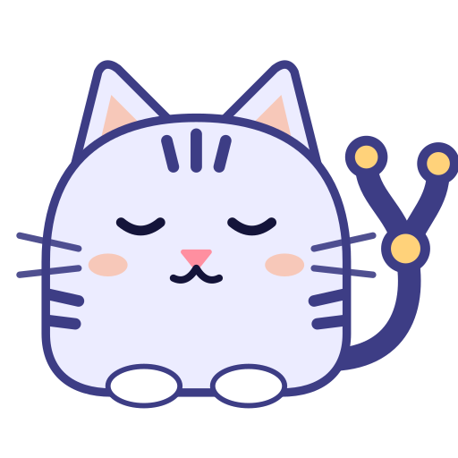

</div>
